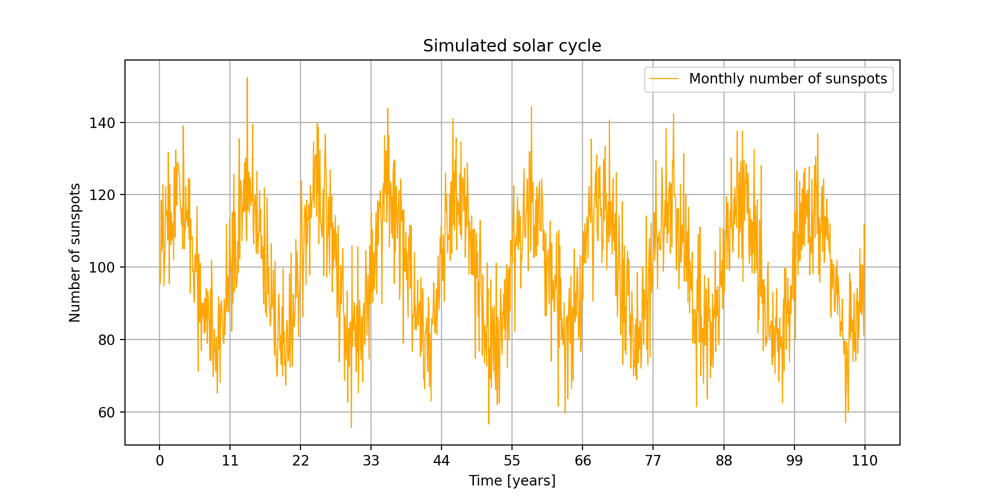
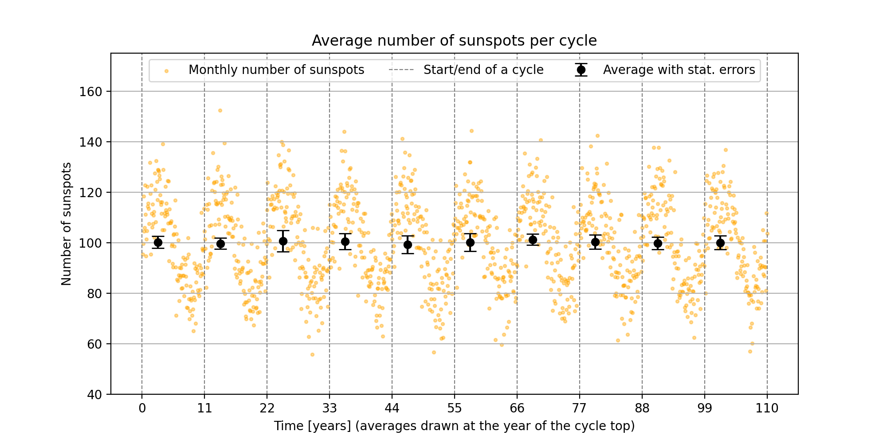
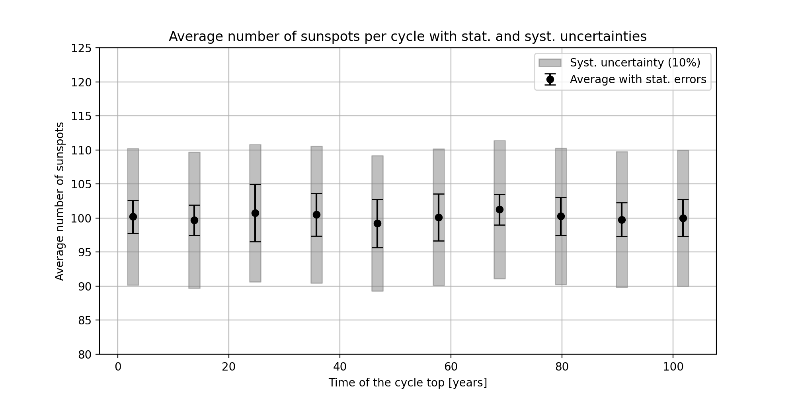

# MAT2007 Week 5 homework: Data visualisation

Frederique Mol (I6391802), Introduction to Programming (MAT2007), Maastricht Science Program

This repository contains my homework for week 5: plots of the solar cycle made with Python and Matplotlib.

## Files

| File | What it is |
|------|------------|
| `HW week 5.py` | Homework 1 and 2 |
| `solar_cycle.txt` | Pseudodata of 10 solar cycles from my week 4 homework (columns: month, cycle, sunspots) |
| `hw1_solar_cycle.png`, `hw1_cycle_averages.png`, `hw2_systematic.png` | Plots made by the homework script |

## How to run

Requirements: Python 3 with `numpy` and `matplotlib` (tested with Python 3.9.6, numpy 2.0.2, matplotlib 3.9.4).

```bash
python3 -m pip install numpy matplotlib
python3 "HW week 5.py"
```

`solar_cycle.txt` must be in the same folder as `HW week 5.py`. The script prints the results in the terminal and saves the three plots as PNG files in its own folder.

## Homework 1: the solar cycle

The solar cycle as a function of time (1320 months, 10 cycles of 11 years):



The average number of sunspots per cycle with its statistical uncertainty, drawn at the year of the cycle top:



The uncertainty is calculated with the sub-sampling technique from week 4: each cycle is split into 11 subsamples of 12 months, and the standard deviation of the 11 subsample means is the statistical uncertainty.

## Homework 2: systematic uncertainty

The same averages, with a systematic uncertainty of 10% of the average of each cycle as a grey box:



## Results

| Cycle | Year of the top | Average | Stat. | Syst. |
|------:|----------------:|--------:|------:|------:|
| 1 | 2.75 | 100.200 | 2.406 | 10.020 |
| 2 | 13.75 | 99.692 | 2.234 | 9.969 |
| 3 | 24.75 | 100.733 | 4.209 | 10.073 |
| 4 | 35.75 | 100.489 | 3.128 | 10.049 |
| 5 | 46.75 | 99.215 | 3.537 | 9.922 |
| 6 | 57.75 | 100.125 | 3.444 | 10.012 |
| 7 | 68.75 | 101.258 | 2.236 | 10.126 |
| 8 | 79.75 | 100.264 | 2.790 | 10.026 |
| 9 | 90.75 | 99.781 | 2.486 | 9.978 |
| 10 | 101.75 | 99.993 | 2.715 | 9.999 |

- All averages are close to 100 (99.2 to 101.3), so there is no trend between the cycles.
- The systematic uncertainty (about 10) is three to four times larger than the statistical one (about 3), so it dominates.

## Use of AI

The improvements to the plots were made with the help of Claude Code AI. This is also noted in the script.
